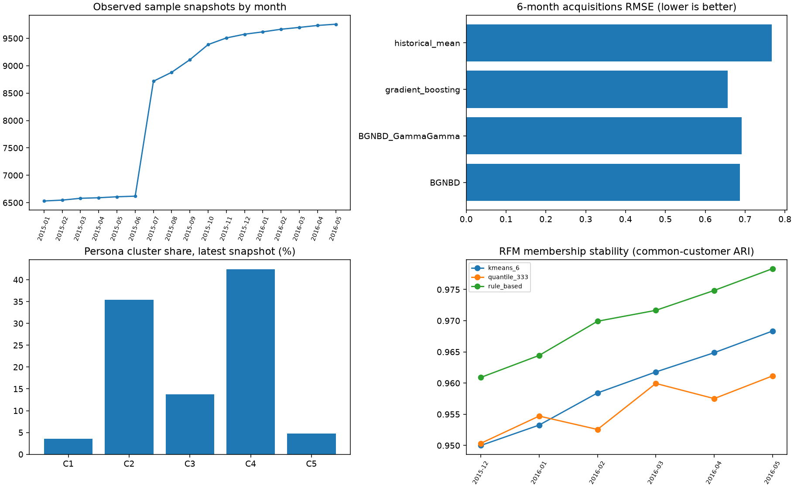

# Track A — bằng chứng bổ sung trên sample cố định 10k

Đây là research development backtest, không phải holdout độc lập, kết quả toàn bộ full data hay measured marketing uplift.

## EDA — 8 finding có số đo

1. Có 143,126 snapshot, 17 tháng (2015-01–2016-05); không phải giao dịch/invoice.
2. Renta thiếu 20.37%; không coi renta là revenue hoặc giá trị giao dịch.
3. Age thiếu 0.14% ở raw; cleaning tuổi ngoài 0–110 thực hiện trong ingest v2, giữ khách trẻ.
4. Cardinality canal_entrada: 102; cần xử lý category chưa thấy khi scoring.
5. Cardinality segmento: 3 và pais_residencia: 21.
6. Trung bình 1.467 sản phẩm trên snapshot có đủ 24 cờ; bảng phân bố giữ riêng incomplete snapshot.
7. Trung bình 0.23% cohort complete hiện tại vắng/không đủ sản phẩm ở tháng kế. Đây không chứng minh rời ngân hàng.
8. Có 6,062 product-level acquisitions được xác minh bằng hai tháng liền kề; khách mới/gap return không tự tạo event.

Xem raw_column_audit.csv (có cod_prov/indrel_1mes), monthly_snapshots.csv, segment_product_trend.csv, portfolio_distribution.csv và panel_presence.csv.

## CLV 6 tháng

| Method | Fit status | RMSE | MAE | Capture10 |
|---|---|---:|---:|---:|
| BGNBD | fit | 0.687539 | 0.452218 | 0.5322405071396554 |
| BGNBD_GammaGamma | fit | 0.691939 | 0.460583 | 0.5087404751232631 |
| gradient_boosting | fit | 0.656428 | 0.339316 | 0.5629762438368444 |
| historical_mean | fit | 0.767239 | 0.459956 | 0.10003185727938833 |

BG/NBD đếm repeat event-month sau first observed event; Gamma-Gamma thử giá trị proxy là số sản phẩm/event-month. Khách không đủ history dùng fallback mean, tỷ trọng ghi riêng trong clv_probabilistic_fit_status.csv. Fit thất bại không được diễn giải là model đã fit.

Train labels tối đa 2015-11 ≤ cutoff 2015-11; nhãn đánh giá đến 2016-05; coverage 99.05%. Không chọn lại model trên backtest 6m. 12m chưa đủ lịch sử cho supervised train/validation/test có mốc thời gian hợp lệ.

Sai số theo RFM, NoObservedEvent/HasEvent và khách history <3 pair nằm trong clv_6m_segment_errors.csv.

## RFM, affinity và persona

Quantile/KMeans/rule được fit ở cùng cutoff và giữ nguyên ở tháng sau; báo actual groups, silhouette, membership ARI và stay rate. Predictive AP/Lift/Brier của nghiên cứu gốc giữ riêng trong research/track_a/docs/02_benchmarks.md, không trộn cohort.

Persona clustering dùng RFM + CLV + portfolio + affinity + demographics; chọn k=5 bằng fit-only silhouette sau ngưỡng min-share 1%. Xem persona_cluster_cards.md và các bảng bootstrap/temporal stability. P1–P6 rule và C1–Ck clustering là hai phương án có version riêng.

Affinity 24×24 có count/support/confidence/lift. Benchmark next-month ở affinity_next_month_benchmark.csv; Apriori bộ ba và item2vec SGNS gốc có notebook 06 cùng benchmark/provenance trong research/track_a. Ma trận tháng cuối chỉ mô tả, không chấm lên nhãn quá khứ.

## Lifecycle và bàn giao

Giữ presence_lifecycle của v2 và thêm lifecycle dùng activity/death ở bảng export. indfall=S → Churned; observed inactive → At-risk trừ New/Win-back; thiếu activity/death không giả là known/eligible. Sự biến mất chỉ là panel absence.

Processed dataset và event partitions nằm private ở processed/. feature_store_spec.json mô tả entity, schema, naming, version, availability và TTL. Chỉ publish processed_manifest.json cùng các file được liệt kê, không đưa customer-level rows lên GitHub. S3 upload phải có destination; chưa có receipt thì chưa coi hoàn tất yêu cầu S3.

## Giới hạn và trạng thái

- Sample này gồm 10k ID cố định giữ toàn bộ tháng; không suy rộng full data.
- Nhãn CLV dài hạn chỉ có khi đủ mọi cặp tương lai, nên có selection bias.
- Event lặp lại, finite product catalog và thời gian tháng vi phạm một số giả định retail BG/NBD/Gamma-Gamma.
- Cluster membership stability không phải causal uplift hay persona đã được business phê duyệt.
- EDA cũ notebook 00 có hạn chế đã audit; 8 finding trên được tính lại từ sample, không chép suy luận cũ.
- MLflow ghi aggregate metrics/artifacts; không log raw, events theo khách hay bảng processed lên tracking.

