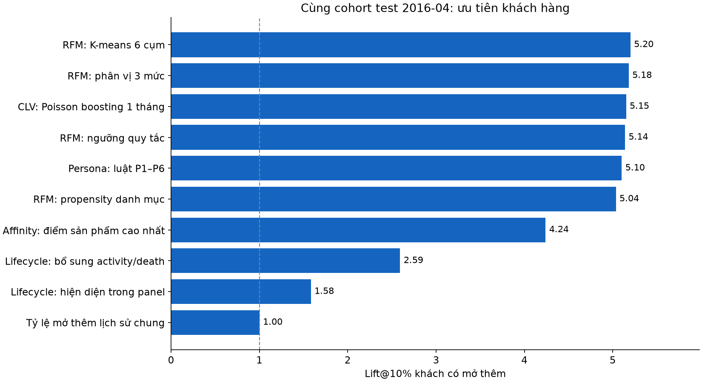
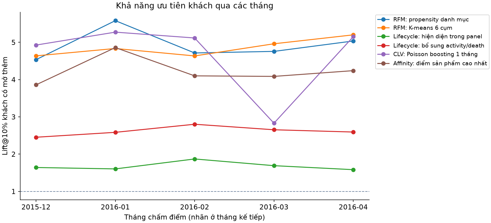

# Track A — Đánh giá thống nhất v2

Nguồn: `full_validation_selected_20261017T200237620339Z_9e8e42ca`. Phạm vi: **full source population, all source months**.
Tháng chấm điểm: 2015-12, 2016-01, 2016-02, 2016-03, 2016-04. Tháng fit RFM: 2015-11. Test được đánh dấu trong config nguồn: 2016-04.

## 1. Cùng cohort và cùng nhãn

| origin | target_month | n_all | n_buyers | product_acquisitions | pair_coverage |
|---|---|---|---|---|---|
| 2015-12 | 2016-01 | 908930 | 26268 | 30956 | 0.996611 |
| 2016-01 | 2016-02 | 914329 | 36071 | 49024 | 0.997883 |
| 2016-02 | 2016-03 | 919070 | 27735 | 35203 | 0.998008 |
| 2016-03 | 2016-04 | 923414 | 26736 | 32962 | 0.998203 |
| 2016-04 | 2016-05 | 926663 | 27875 | 35843 | 0.998265 |

## 2. Ưu tiên khách hàng — tháng cuối

| Phương pháp | AP | AUC | Lift10 khách | Capture10 sản phẩm | Brier |
|---|---|---|---|---|---|
| Tỷ lệ mở thêm lịch sử chung | 0.030081 | 0.500000 | 1.000000 | 0.100000 | 0.029207 |
| RFM: propensity danh mục | 0.199515 | 0.772109 | 5.035470 | 0.525036 | 0.026448 |
| CLV: Poisson boosting 1 tháng | 0.213517 | 0.833673 | 5.150852 | 0.554278 | 0.026221 |
| Affinity: điểm sản phẩm cao nhất | 0.115433 | 0.754227 | 4.239641 | 0.463494 | — |
| Lifecycle: hiện diện trong panel | 0.045277 | 0.533073 | 1.582868 | 0.160999 | 0.028904 |
| Lifecycle: bổ sung activity/death | 0.075736 | 0.772026 | 2.592650 | 0.261916 | 0.028072 |
| Persona: luật P1–P6 | 0.135552 | 0.850451 | 5.101632 | 0.516324 | 0.026888 |
| RFM: K-means 6 cụm | 0.128643 | 0.820093 | 5.199851 | 0.525915 | 0.027009 |
| RFM: phân vị 3 mức | 0.124998 | 0.811402 | 5.180688 | 0.522821 | 0.027039 |
| RFM: ngưỡng quy tắc | 0.145152 | 0.823421 | 5.138553 | 0.521199 | 0.026851 |

## 3. Trung bình đều các tháng

| Phương pháp | AP | AUC | Lift10 khách | Capture10 sản phẩm |
|---|---|---|---|---|
| Tỷ lệ mở thêm lịch sử chung | 0.031512 | 0.500000 | 1.000000 | 0.100000 |
| RFM: propensity danh mục | 0.207191 | 0.757816 | 4.924096 | 0.511829 |
| CLV: Poisson boosting 1 tháng | 0.150386 | 0.810334 | 4.659043 | 0.501235 |
| Affinity: điểm sản phẩm cao nhất | 0.118486 | 0.738241 | 4.228426 | 0.452838 |
| Lifecycle: hiện diện trong panel | 0.047209 | 0.538303 | 1.677578 | 0.170342 |
| Lifecycle: bổ sung activity/death | 0.078165 | 0.771060 | 2.617043 | 0.264348 |
| Persona: luật P1–P6 | 0.122983 | 0.779465 | 4.302846 | 0.432741 |
| RFM: K-means 6 cụm | 0.126578 | 0.807017 | 4.853102 | 0.487886 |
| RFM: phân vị 3 mức | 0.120667 | 0.796288 | 4.788612 | 0.479007 |
| RFM: ngưỡng quy tắc | 0.144494 | 0.811229 | 5.091750 | 0.510540 |

## 4. Gợi ý sản phẩm — tháng cuối

| method | n_all | n_buyers | map_at_7_all | map_at_7_buyers | recall_at_7_buyers | evaluation_mode |
|---|---|---|---|---|---|---|
| affinity_temporal_v2 | 926663 | 27875 | 0.021699 | 0.721355 | 0.974098 | recomputed |
| past_opportunity_popularity | 926663 | 27875 | 0.019433 | 0.646028 | 0.970950 | recomputed |
| saved_v2_evaluation_ranker | 926663 | 27875 | 0.025341 | 0.842417 | 0.987901 | imported completed test report; counts checked, predictions not rerun |

## 5. Ổn định nhóm — trung bình các cặp tháng

| method | same_label_rate | membership_ARI | rate_rank_spearman |
|---|---|---|---|
| lifecycle_presence | 0.990789 | 0.581552 | 1.000000 |
| lifecycle_activity | 0.980270 | 0.940854 | 0.950000 |
| persona_rules | 0.958056 | 0.938830 | 0.964286 |
| rfm_kmeans_6 | 0.949056 | 0.960452 | 0.971429 |
| rfm_quantile_333 | 0.923091 | 0.958489 | 0.982143 |
| rfm_rule_based | 0.922300 | 0.970166 | 0.941558 |

## Cách đọc độ đo

- AP là average precision của nhãn có acquisition. AUC đo phân biệt người có và không có acquisition.
- Lift10 khách = tỷ lệ người có acquisition trong top 10% / tỷ lệ chung cùng cohort.
- Capture10 sản phẩm = số product acquisitions có trọng số ở top 10% / tổng acquisitions. Lift10 sản phẩm = Capture10 / 0,1.
- Brier càng thấp càng tốt, chỉ có khi adapter có xác suất sự kiện. MAE/RMSE/calibration count chỉ báo cho CLV trong CSV.
- MAP@7 all = MAP@7 buyers × tỷ lệ buyers theo đúng code hiện tại. MAP all tối đa bằng buyer prevalence; recall buyers có trần riêng nếu một khách mở quá 7 sản phẩm.
- Các bảng trung bình dùng trọng số bằng nhau cho từng tháng, không gọi là kết quả pooled và không gọi n_all của nhiều tháng là số khách duy nhất.

## Phạm vi và giới hạn

- Đây là rolling development backtest trên cùng nguồn v2; các tháng đã được dùng trong nghiên cứu trước. Không gọi là holdout chưa từng xem.
- Mọi phương pháp dùng đúng cùng cặp snapshot liên tiếp đầy đủ tại mỗi tháng. Không lọc riêng người mua, khách có lịch sử dài hoặc trạng thái active cho từng phương pháp.
- Mục tiêu chung là có mở thêm ít nhất một sản phẩm ở tháng kế tiếp. Capture sản phẩm và RMSE dùng mục tiêu đếm số sản phẩm mở thêm, được ghi thành cột riêng.
- Top 10% dùng trọng số phân số cho toàn bộ nhóm đồng điểm ở ngưỡng chọn. Không phá hòa theo ID. Baseline điểm bằng nhau luôn có lift 1.
- RFM group, lifecycle và persona được chuyển thành điểm bằng tỷ lệ mở thêm trong các cặp lịch sử đã hoàn tất, làm trơn với 100 cặp giả theo tỷ lệ chung. Đây là adapter đánh giá mới, không phải tái tạo các scorecard notebook gốc.
- K-means và ngưỡng phân vị fit một lần trên toàn cohort đầy đủ ở tháng fit, không dùng nhãn, rồi giữ nguyên. Điểm nhóm chỉ cập nhật bằng nhãn đã biết đến tháng chấm điểm.
- Lifecycle presence là feature catalog v2. Lifecycle activity/death là enrichment riêng của dashboard; kết quả được báo thành dòng riêng. Cohort này chỉ gồm khách đang quan sát đầy đủ, nên không kiểm định trạng thái khách vắng At-risk/Churned của presence lifecycle.
- CLV là baseline-numeric Poisson boosting 1 tháng đã lưu tại từng origin. Brier của CLV dùng phép đổi 1-exp(-lambda), dựa trên giả định Poisson; không tuyên bố đã hiệu chỉnh xác suất riêng.
- Affinity dùng đúng công thức temporal v2, window 3 tháng, prior 1000, thứ tự PRODUCTS cố định và mask sản phẩm đang sở hữu. Điểm khách hàng là affinity cao nhất trong các sản phẩm chưa sở hữu. Đây là adapter ưu tiên khách mới, không phải xác suất đã hiệu chỉnh. Brier của affinity để trống.
- Bảng recommendation đánh giá affinity và popularity bằng cùng nhãn 24 sản phẩm. Dòng saved_v2_evaluation_ranker nhập từ test report đã hoàn tất, kiểm tra số khách/số người mua khớp; không nói đã chạy lại dự đoán của ranker.
- Rate-rank Spearman đo thứ hạng tỷ lệ acquisition của nhóm có ít nhất 100 khách ở cả hai tháng; membership ARI/stay rate đo thành viên. Hai loại ổn định có ý nghĩa khác nhau.
- Không so các trị số lift này với lift đồng sở hữu sản phẩm 24×24 hoặc kết luận hiệu quả can thiệp marketing. Không trộn số notebook gốc vào bảng này.

## Các file chi tiết

- `customer_metrics_by_month.csv`: AP/AUC/lift/capture/Brier, lỗi count, fallback và cohort hash của từng phương pháp/tháng.
- `product_metrics_by_month.csv`: MAP@7, Recall@7, mẫu số, trần lý thuyết và nguồn tính.
- `group_rates_by_month.csv`: n, events, acquisition rate, KTC Wilson 95%, lift nhóm và điểm ước tính từ quá khứ.
- `group_stability_by_month.csv`: rate-rank Spearman, membership ARI và stay rate.
- `cohort_audit.csv`: coverage, loại trừ, số người mua, tổng acquisitions và hash tập ID (không chứa ID cá nhân).
- Manifest đầy đủ và hash nguồn lưu trong output private; bản báo cáo chỉ chứa aggregate.
